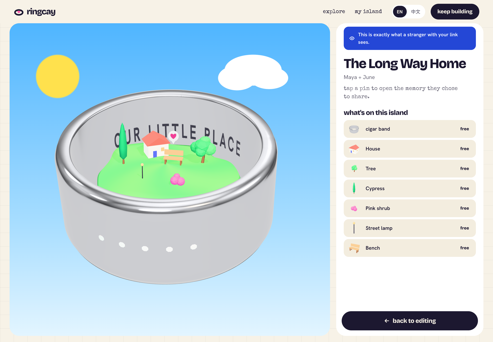

# ringcay

English · [简体中文](README.zh-CN.md)

**Turn the story behind a ring into a place of your own. Create a keepsake world for a couple or a circle of friends, and give each object the photos and stories that explain why it belongs.**

[Make your island →](https://cynthiawongss.com/ringcay/)


*Concept illustration, not a screenshot; the people and stories in it are made up. The screenshots below show the actual browser prototype.*

## Show what makes this ring yours

The idea comes from couples and friends making keepsake rings together. An engraving or a chosen motif can stand for something only they understand. ringcay unfolds those meanings into a small world where each story can be seen and opened.

A bench might hold an evening when two people lost track of time talking. A table might remember a group of friends coming together. A place from a shared trip might become an object on the island. Each choice can hold a photo, a date and the reason you remember it.

Keep those memories to yourself, or open selected stories so others can understand what the details mean to you.

| Make it yours | What you can do |
| --- | --- |
| Choose a ring | Pick from 24 shapes in six families. Adjust supported metal and stone colours, and engrave a few words inside the band. |
| Build a place | The island follows the ring's shape. Place and drag 19 kinds of objects, including houses, trees, benches and a lighthouse. |
| Keep a memory | Give an object a label, a photo, a title, a date and a story. |
| Choose what travels | Preview the island as a visitor. Open individual memories for sharing, or leave their contents private. |

Different rings create different places: a band holds a floating island in its opening; a flat signet uses its top as the ground; a raised setting holds an island above it; an open ring creates two islets with a bridge.

## A bench becomes a story

This fictional example was built in the live app: a **cigar band in silver**, the engraving **OUR LITTLE PLACE**, and a bench on an island called **The Long Way Home**.

The bench holds a story about missing a bus and turning a goodbye into a three-hour conversation. Its contents stay out of the visitor preview until that memory is opened for sharing.



[See the memory editor](assets/02-memory-editor.png) · [Open the screenshot of the story](assets/04-memory-open.png)

## Start with a ring

1. [Open ringcay](https://cynthiawongss.com/ringcay/) and choose **start our ring**.
2. Pick a ring, customise it and select **grow the island**.
3. Add objects, drag them into place, then tap an object to add its memory.
4. In **share**, choose what visitors may see. Use **see it as a stranger would** before copying a link.

## The same place, day and night

The world automatically follows your device's clock, changing from a bright daytime scene to a night setting with lights.

[Preview day](https://cynthiawongss.com/ringcay/?theme=day) · [Preview night](https://cynthiawongss.com/ringcay/?theme=night)

These links force a mode for preview; the normal site follows local device time. The interface supports English and Simplified Chinese.

## What this prototype does—and doesn't—store

| Current behaviour | What it means |
| --- | --- |
| Browser-only saving | The island uses `localStorage`; photos use IndexedDB. There are no accounts or cloud sync. Clearing site data can remove your work. |
| Public snapshot links | The link itself carries the island's public snapshot. It is not a live, shared editing session or a backup of private memories. |
| Individual visibility choices | Private memory contents are omitted from the snapshot. You can also hide names and the engraving; the island's appearance and title remain part of it. |
| Demo checkout | Price labels and checkout are part of the prototype. No real payment is taken, and no physical ring is ordered. |
| Sample gallery | The six islands on the home page are examples, not a live community feed. |

“Private” here describes what is excluded from a share link; this prototype has no account-based access system. The page needs internet access to load Three.js and fonts from public CDNs.

## Run locally

Requires Python 3 and a modern browser. No package installation is needed.

```sh
python3 serve.py
```

Open **http://localhost:4173**. The server serves the `app/` directory. The interface lives in `app/js/main.js`, 3D rendering in `app/js/world.js`, ring geometry in `app/js/rings.js`, and saving and sharing in `app/js/store.js`.

## Rights

Copyright © 2026 Cynthiawongss. All rights reserved. This is a public showcase, not an open-source project. Reuse of the code, generated 3D models, designs and images requires written permission. Third-party software and fonts retain their own licenses. See [LICENSE](LICENSE).
