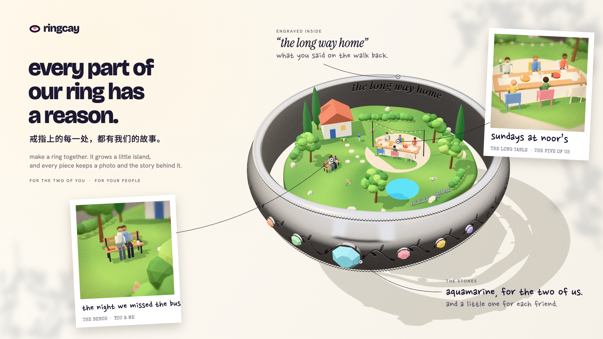
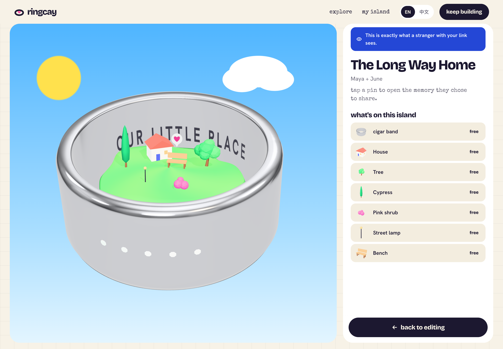

# ringcay

[English](README.md) · 简体中文

**把戒指背后的故事，变成属于你们的纪念空间。为恋人或朋友设计一枚戒指，让共同经历成为里面的小世界，再用照片和文字讲清每个物件为什么存在。**

[开始做你的小岛 →](https://cynthiawongss.com/ringcay/)



*上图为概念插图，不是产品截图，图中人物和故事均为虚构；下方截图来自实际运行的浏览器原型。*

## 让别人看懂，这枚戒指为什么属于你们

灵感来自情侣或朋友一起做纪念戒指：一段刻字、一个图案，往往代表一件只有彼此知道的事。ringcay 想把这些意义展开，变成一个可以看见、可以点开故事的小世界。

一张长椅，可以代表两个人聊到忘记时间的傍晚；一张餐桌，可以记住朋友们每次见面的聚会；一次旅行里见过的景物，也可以成为岛上的物件。放进去的不只是装饰，还有那张照片、那一天，以及你为什么记得它。

你可以把这些回忆留给自己，也可以开放选中的故事，让别人看懂每个细节背后的意义。

| 想做什么 | 可以怎样玩 |
| --- | --- |
| 设计戒指 | 从六大类、24 款戒指中选择，调整款式支持的金属和宝石颜色，在戒圈内侧刻上几句话。 |
| 搭建小岛 | 岛的形态跟随戒指变化。可放置、拖动 19 类物件，包括房屋、树木、长椅和灯塔。 |
| 放入回忆 | 给物件起名，加入照片、标题、日期和故事。 |
| 决定分享什么 | 先看访客预览，再逐条开放想分享的回忆，也可以保留所有私密内容。 |

不同戒指长出不同的小岛：普通戒圈让岛悬浮在中间，平顶印章戒以戒面作为地面，有凸起镶座的戒指让岛浮在上方，开口戒则长出两座用桥连接的小岛。

## 一张长椅，变成一段故事

这个虚构示例是在网站里实际搭建的：选择银色 **cigar band** 戒圈，刻上 **OUR LITTLE PLACE**，再在名为 **The Long Way Home** 的岛上放置长椅。

长椅里记着一个故事：两人错过公交，一句告别变成了三个小时的长谈。未开放这条回忆时，访客预览只展示小岛；设为公开后，访客才能点开故事。



[查看回忆编辑界面](assets/02-memory-editor.png) · [查看点开故事后的截图](assets/04-memory-open.png)

## 从一枚戒指开始

1. [打开 ringcay](https://cynthiawongss.com/ringcay/)，点击 **开始做戒指**。
2. 选择款式、调整外观与刻字，再让戒指长出小岛。
3. 放置物件、拖动调整位置，然后点开物件，写入回忆。
4. 在分享步骤中选择访客能看到的内容，先看访客预览，再复制链接。

## 白天与夜晚，跟着你的时间变化

小世界会随设备时间自动切换白天与夜晚。同一座岛，白天明亮，夜晚换上夜色与灯光。

[查看白天](https://cynthiawongss.com/ringcay/?theme=day) · [查看夜晚](https://cynthiawongss.com/ringcay/?theme=night)

这两个链接用于指定模式预览，正常打开网站会跟随设备时间。界面支持英文和简体中文。

## 当前原型怎样保存与分享

| 当前行为 | 使用时意味着什么 |
| --- | --- |
| 保存在浏览器 | 小岛数据使用 `localStorage`，照片使用 IndexedDB。没有账号和云端同步，清理网站数据可能删除作品。 |
| 链接携带公开快照 | 分享内容直接包含在链接里，不是多人实时编辑，也不是私密回忆的完整备份。 |
| 逐条决定可见性 | 私密回忆的内容不会写入公开快照；姓名和刻字也可以隐藏，小岛外观和标题仍会包含在快照中。 |
| 结账仅为演示 | 页面中的标价和结账属于原型流程，不会实际扣款，也不会订购实体戒指。 |
| 首页展示示例 | 首页六座小岛是预设案例，尚未开放真实社区。 |

这里的“私密”指内容不会包含在分享链接中；当前还没有基于账号的访问权限系统。页面通过公共 CDN 加载 Three.js 和字体，需要联网。

## 本地运行

需要 Python 3 和现代浏览器，无需安装项目依赖。

```sh
python3 serve.py
```

打开 **http://localhost:4173**。服务提供 `app/` 目录中的页面；界面逻辑位于 `app/js/main.js`，3D 渲染位于 `app/js/world.js`，戒指几何体位于 `app/js/rings.js`，存档与分享位于 `app/js/store.js`。

## 使用许可

版权所有 © 2026 Cynthiawongss，保留所有权利。本仓库用于公开展示，不是开源项目。复用代码、代码生成的 3D 模型、设计和图片，需要书面授权。第三方软件与字体仍适用各自许可。详见 [LICENSE](LICENSE)。
